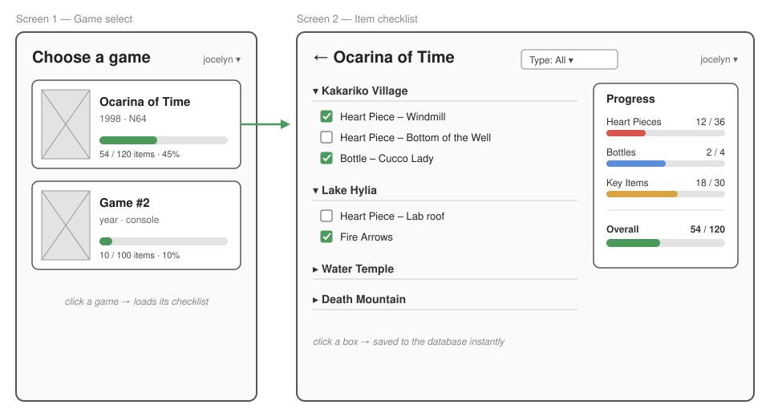
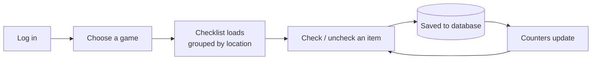
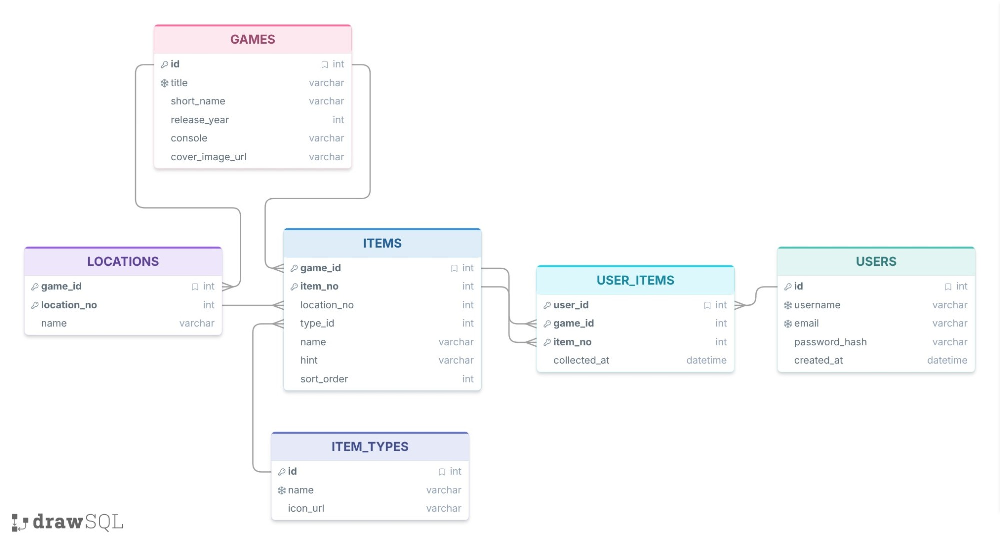
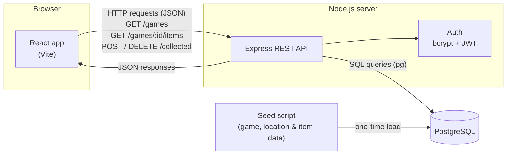

# Zelda Item Tracker — Project Proposal

**Author:** Jocelyn Perucca  
**Repo:** https://github.com/jocelynperucca/zelda-tracker  
**Project log:** [PROJECT_LOG.md](PROJECT_LOG.md)

---

## 1. Purpose and goals

*The Legend of Zelda* games are full of collectibles: heart pieces, bottles, upgrades and key items hidden all over the map. It's easy to lose track of which ones you've already found, especially across several games or when you come back to a save months later.

**Zelda Item Tracker** is a web app where you:
1. **Log in** to your own account, so several people can each keep their own progress.
2. **Choose a game** from a list.
3. **See every item in that game, grouped by where it's found** (Kakariko Village, Lake Hylia, Water Temple…).
4. **Check items off** as you collect them. Each click is saved to the database right away.
5. **Watch your counters**, like *Heart Pieces: 12 / 36*, update as you go.

When you come back and click a game, your checklist loads with everything you've already marked.

### What it looks like

### How someone uses it

### Goals

**MVP (must have)**
- [ ] User accounts: register, log in, log out
- [ ] Game list with overall progress per game
- [ ] Item checklist for a game, grouped by location
- [ ] Check / uncheck items, saved to PostgreSQL
- [ ] Progress counters per item type (Heart Pieces 12 / 36, etc.)
- [ ] Two games fully entered: **Ocarina of Time** and one more (still choosing)

**Stretch (if time allows)**
- [ ] Filter the checklist by item type
- [ ] Hide collected items
- [ ] **"Show next item" button:** hides the full list and shows only the next item you haven't collected, in playthrough order (location order, then `sort_order`). Checking it off moves on to the following one.
- [ ] Item icons and game cover art
- [ ] Hints for where to find each item

---

## 2. Initial ERD

Six tables: `users`, `games`, `locations`, `item_types`, `items`, and `user_items` (the junction table that records which user collected which item). Items and locations are numbered separately in each game, so they use composite keys like `(game_id, item_no)`.

See **[docs/ERD.md](docs/ERD.md)** for every table, relationship, and design decision.

---

## 3. System design

| Piece | Technology | Job |
|-------|------------|-----|
| Frontend | React + Vite | Game list, checklist, counters, login forms |
| Backend | Node.js + Express | REST API between the frontend and the database |
| Auth | bcrypt + JWT | Hashes passwords. Issues a token so the API knows which user is asking. |
| Database | PostgreSQL | Stores users, games, locations, items, and collected items |
| Seed script | Node script + SQL | Loads each game's locations and items into the database |
| Hosting | Local only | Runs on my machine for the demo |

### Planned API

| Method | Route | What it does |
|--------|-------|--------------|
| POST | `/auth/register` | Create an account |
| POST | `/auth/login` | Log in and get a token |
| GET | `/games` | List the games, with my progress for each |
| GET | `/games/:gameId/items` | All items for a game, grouped by location, with my collected status |
| POST | `/games/:gameId/items/:itemNo/collect` | Mark an item collected (inserts a `user_items` row) |
| DELETE | `/games/:gameId/items/:itemNo/collect` | Unmark it (deletes the row) |

---

## 4. Daily goals (Nov 16 – Dec 10)

| Date | Goal |
|------|------|
| **Mon 11/16** | ✅ Project idea, project log, ERD, and this proposal |
| **Tue 11/17** | Set up the project: React (Vite) frontend, Express backend, local PostgreSQL. Get "hello world" talking end to end. |
| **Wed 11/18** | Write `schema.sql` (all six tables with PKs and FKs) and create the database |
| **Thu 11/19** | Research Ocarina of Time: list its locations and item types |
| **Fri 11/20** | Enter OoT items (heart pieces, bottles, key items) |
| **Sat 11/21** | Write the seed script and load OoT into the database |
| **Mon 11/23** | API: `GET /games` and `GET /games/:gameId/items` |
| **Tue 11/24** | Frontend: game list page and read-only checklist grouped by location |
| **Wed 11/25 – Sat 11/28** | Thanksgiving break. Light work, catch up on anything behind. |
| **Mon 11/30** | Auth backend: register, log in, password hashing, JWT |
| **Tue 12/1** | Auth frontend: login and register forms, keep the user logged in |
| **Wed 12/2** | Check / uncheck: collect API routes, wire up the checkboxes |
| **Thu 12/3** | Progress counters per item type, and overall % on the game list |
| **Fri 12/4** | Choose game #2 and research its locations and items |
| **Sat 12/5** | Seed game #2. Test that two games and two users stay separate. |
| **Mon 12/7** | Styling and polish. Stretch: item type filter and "Show next item" button. |
| **Tue 12/8** | Testing and bug fixes |
| **Wed 12/9** | Final report, README with setup steps, demo practice |
| **Thu 12/10** | Final submission |

I'll add a [project log](PROJECT_LOG.md) entry and commit after each work session.

---

## 5. UX sketch

The wireframe in [section 1](#what-it-looks-like) shows the two main screens:

- **Game select:** a card for each game with cover art and a progress bar.
- **Checklist:** items grouped under collapsible location headings, each with a checkbox. A **Progress** sidebar shows counters per item type and overall. A **Type** dropdown filters the list (stretch goal).
