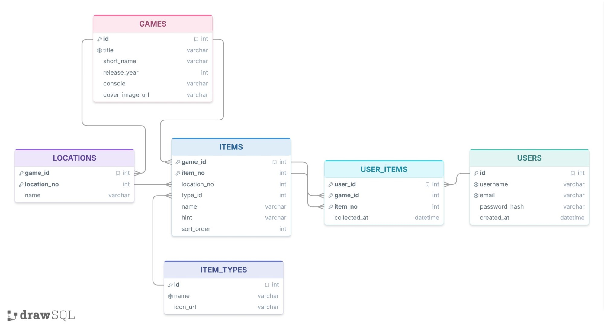

# Entity Relationship Diagram

*Drawn in DrawSQL.*

## Tables

| Table | Primary key | What it stores |
|-------|-------------|----------------|
| **users** | `id` | People using the tracker. `username` and `email` are unique. Passwords are stored only as a hash. |
| **games** | `id` | Each Zelda game. `title` is unique. |
| **locations** | `(game_id, location_no)` | Regions and dungeons where items are found, numbered separately in each game. |
| **item_types** | `id` | Item categories (Heart Piece, Bottle, Key Item…), shared by every game. |
| **items** | `(game_id, item_no)` | Every individual collectible, numbered separately in each game. Each one belongs to a location and a type. |
| **user_items** | `(user_id, game_id, item_no)` | Which items each user has collected. |

## Relationships

| Relationship | Cardinality | Foreign key |
|--------------|-------------|-------------|
| games → locations | 1 to many | `locations.game_id` → `games.id` |
| games → items | 1 to many | `items.game_id` → `games.id` |
| locations → items | 1 to many | `items.(game_id, location_no)` → `locations.(game_id, location_no)` |
| item_types → items | 1 to many | `items.type_id` → `item_types.id` |
| users → user_items | 1 to many | `user_items.user_id` → `users.id` |
| items → user_items | 1 to many | `user_items.(game_id, item_no)` → `items.(game_id, item_no)` |

Users and items have a **many-to-many** relationship: one user collects many items, and one item is collected by many users. The `user_items` junction table resolves it.

> **Note:** DrawSQL draws one line per column, so composite foreign keys show up as two lines. For example, the two lines from `user_items` to `items` are one relationship: `(game_id, item_no)`.

## Design decisions

1. **Every heart piece is its own item.** Each item has its own location, so the checklist can be grouped by where items are found and shows exactly which ones are missing.
2. **Counters are calculated, not stored.** The "Heart Pieces: 12 / 36" counter counts the user's collected items of that type. Storing the count separately could get out of sync with the checkboxes.
3. **Locations belong to a game.** Kakariko Village in Ocarina of Time and in Breath of the Wild are different places with different items, so each location row is tied to a game.
4. **Items and locations are numbered per game.** Item numbers restart at 1 in each game, so an item is identified by `(game_id, item_no)`. Because `items` uses the same `game_id` column for its game and its location, an item can't point to a location in a different game.
5. **`user_items` has no `collected` column.** If a row exists, the item is collected. Checking a box inserts a row, and unchecking deletes it. The composite primary key stops the same item being recorded twice for one user.
6. **Item types are a table, not free text.** Choosing from a fixed list prevents typos like "Heart piece" vs "Heart Piece" that would break the counters.

## How the features use the design

| Feature | How it works |
|---------|--------------|
| Click a game → see its items grouped by location | Select `items` joined to `locations` where `game_id` matches, ordered by location and `sort_order` |
| Show which items I've collected | `LEFT JOIN user_items` on `user_id`, `game_id` and `item_no`. Items with no matching row are unchecked. |
| Check / uncheck an item | Insert / delete a `user_items` row |
| Heart Piece counter | Count the user's `user_items` rows for that game whose item type is "Heart Piece", out of all Heart Piece items in that game |
| Separate progress per user | `user_id` is part of the `user_items` key |
