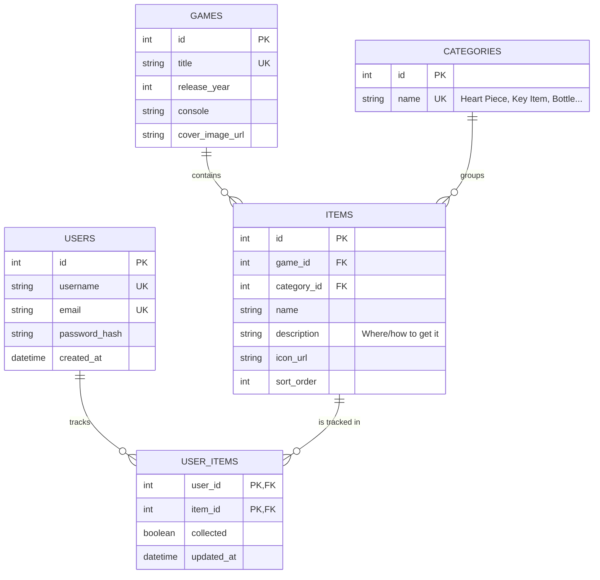

# Entity Relationship Diagram



## Tables

| Table | What it stores | Key points |
|-------|----------------|------------|
| **users** | People using the tracker | `username` and `email` are unique. Store a password hash, never the password. |
| **games** | Each Zelda game (Ocarina of Time, Breath of the Wild…) | Reference data, loaded by a seed script. |
| **categories** | Item types (Heart Piece, Key Item, Upgrade, Bottle, Dungeon Item…) | Shared across games so you can filter the same way in every game. |
| **items** | Every trackable item in every game | Belongs to one game and one category. `sort_order` keeps the checklist in a sensible order. |
| **user_items** | Which items each user has collected | A join table between users and items. The primary key is `(user_id, item_id)`, so a user can't have duplicate rows for the same item. |

## Relationships

- **Game 1 — many Items:** each item belongs to exactly one game. The same item in two games (for example the Hookshot in OoT and in Link's Awakening) gets two rows, because location and description differ per game.
- **Category 1 — many Items:** each item has one category.
- **User many — many Items** (through **user_items**): a user tracks many items, and an item is tracked by many users.

## How "click a game → populate the list" works

When a user opens a game, one query returns every item for that game along with whether this user has collected it:

```sql
SELECT i.id, i.name, c.name AS category,
       COALESCE(ui.collected, FALSE) AS collected
FROM items i
JOIN categories c ON c.id = i.category_id
LEFT JOIN user_items ui
       ON ui.item_id = i.id AND ui.user_id = :userId
WHERE i.game_id = :gameId
ORDER BY c.name, i.sort_order;
```

The `LEFT JOIN` matters. Items the user has never touched have no `user_items` row, and they still show up, as unchecked.

Checking or unchecking an item is an upsert, which inserts the row or updates it if it already exists:

```sql
INSERT INTO user_items (user_id, item_id, collected, updated_at)
VALUES (:userId, :itemId, :collected, CURRENT_TIMESTAMP)
ON CONFLICT (user_id, item_id)
DO UPDATE SET collected = excluded.collected, updated_at = excluded.updated_at;
```

Progress per game (e.g. "34 / 120") is a `COUNT` over the same join. It isn't stored anywhere, so it can never go out of sync.

## Design decisions

- **Users are in from the start.** Adding `user_id` later would mean changing the progress table and every query. With users built in now, a single-user version is just one hard-coded user.
- **Categories are a table, not a text column.** This prevents typos ("Heart piece" vs "Heart Piece") and makes filtering easy.
- **There is no row per item per user until the user touches the item.** This keeps `user_items` small, and the `LEFT JOIN` fills in the gaps.

## Possible extensions

- **regions** (`id`, `game_id`, `name`): dungeons and areas, with `items.region_id` so items can be grouped by where they're found.
- **platforms** plus a **game_platforms** join table, if you want to show that a game came out on several consoles (e.g. Twilight Princess on GameCube, Wii and Wii U).
- **user_items.notes** for personal notes on an item.
